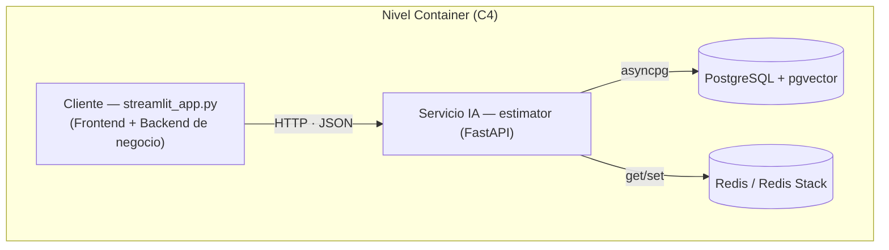
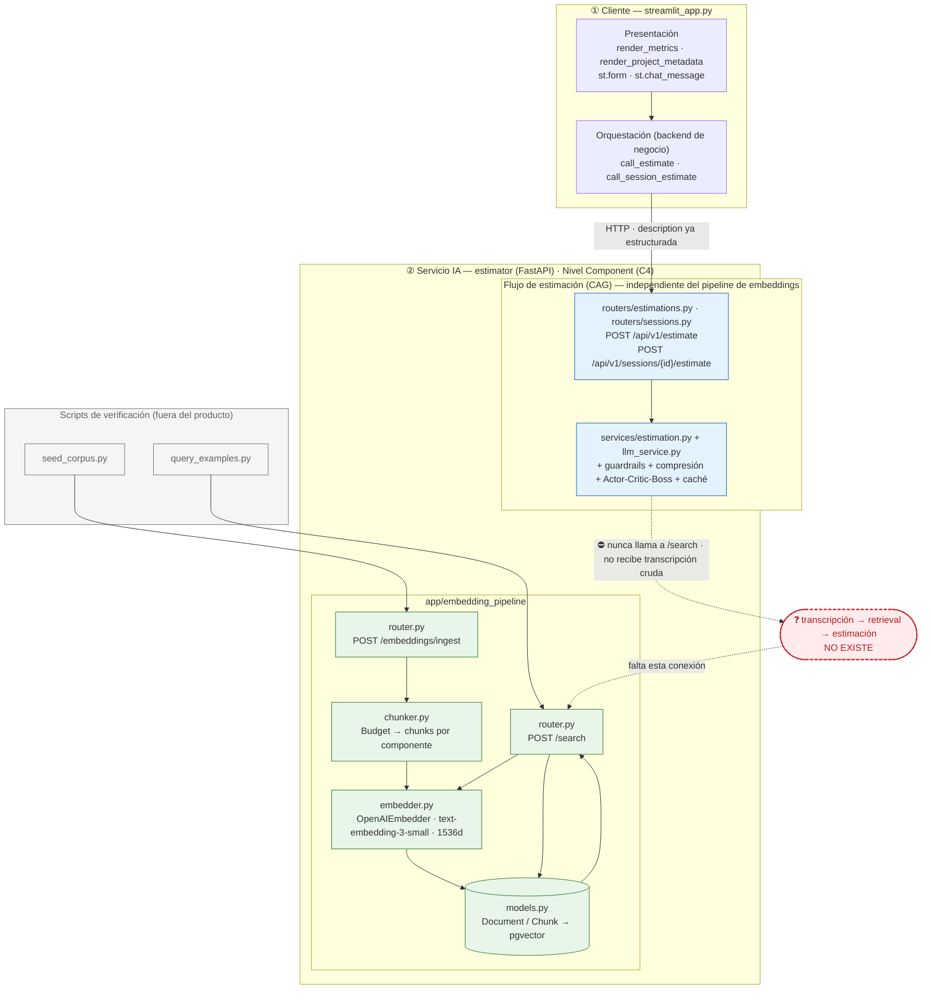
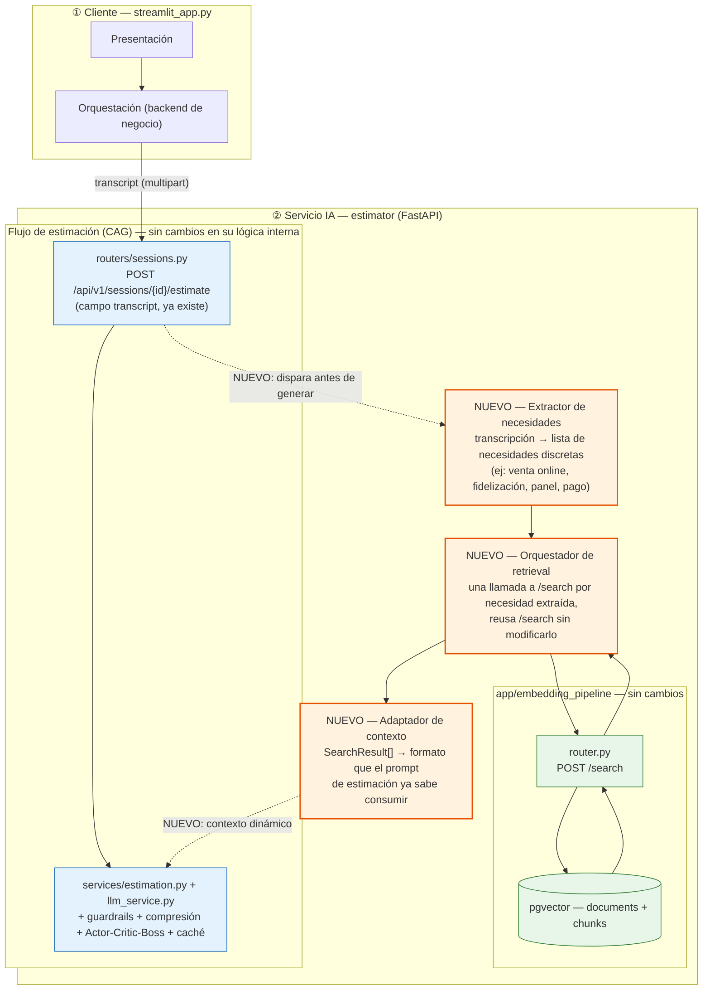

# Diagnóstico arquitectónico — servicio estimator

---

## 1. Diagrama de la arquitectura actual

Dos vistas, inspiradas en el modelo C4: **Container** (las tres capas, sin bajar de nivel) y
**Component** (zoom al servicio IA).

### Nivel Container (C4)



### Nivel Component (zoom al Servicio IA)



**Lectura del diagrama.** Verde: el pipeline de embeddings (`app/embedding_pipeline`) — trocea,
embebe y persiste en pgvector, y responde búsquedas por similitud coseno. Está completo y funciona,
pero nadie en el producto lo invoca: solo lo ejercitan los scripts de verificación (gris). Azul: el
flujo de estimación (`/api/v1/estimate`), con su CAG, guardrails, compresión y Actor-Critic-Boss —
funciona y es lo único que el cliente real llama. El borde rojo punteado marca el hueco: ninguno de
los dos endpoints de ese flujo llama a `/search`. `POST /api/v1/estimate` tampoco podría recibir una
transcripción cruda sin truncarla (su `description` tiene un tope de caracteres); `POST
/api/v1/sessions/{id}/estimate` sí tiene un campo `transcript` sin ese tope, pero igual no dispara
ninguna búsqueda. Esa doble ausencia — sin retrieval, y sin que el único punto de entrada apto para
texto libre lo aproveche — es el hueco que hay que cerrar para completar el camino de una
transcripción cruda hasta una estimación generada (ver sección 3, fallos 4 y 5).

---

## 2. Trace anotado de `02_ambiguous.txt`

Transcripción: Rubén Castaño, dueño de una tienda física de productos gourmet ("Casa Castaño"),
quiere vender por internet, un programa de fidelización por puntos, un panel de control con
gráficas de ventas/stock, pago con tarjeta seguro, y un correo de confirmación al comprar. No
menciona ninguna tecnología concreta ni presupuesto.

### Paso 1 — Embeber la transcripción completa

`/embeddings/ingest` no sirve acá: solo acepta un `Budget` estructurado como `content`, no texto
libre. Se usa el módulo de embeddings directamente (`OpenAIEmbedder.embed_one`, el mismo método que
usa `/search` internamente), vía un script corto de trace:

```bash
PYTHONPATH=. uv run python scripts/trace_embed_vector.py examples/transcripts/02_ambiguous.txt
```

Salida:

```
dimension=1536
norm=0.999812
first_component=0.006241
last_component=0.018997
```

La dimensión (1536) y la norma (≈1.0, por construcción de `text-embedding-3-small`) son las
esperables. El vector no representa "lo que el cliente necesita construir": representa un promedio
semántico de *toda* la transcripción, incluyendo las muletillas, las dudas de Rubén, los comentarios
sobre su sobrina y su mujer, y las dos o tres frases con señal real (vender online, fidelización,
panel, pago con tarjeta, email). Esa mezcla es la que después diluye la búsqueda.

### Paso 2 — Búsqueda semántica (top-5)

```bash
jq -n --rawfile q examples/transcripts/02_ambiguous.txt --argjson k 5 '{query: $q, k: $k}' \
  > search_payload.json

curl -s -X POST "http://localhost:8000/search" \
  -H "Content-Type: application/json" \
  --data-binary @search_payload.json | jq '.'
```

Respuesta cruda (el campo `query` se truncó a `"…"` para legibilidad — es el contenido íntegro de
`examples/transcripts/02_ambiguous.txt`, igual al del Paso 1):

```json
{
  "query": "…",
  "k": 5,
  "search_time_ms": 1080.1,
  "results": [
    {
      "chunk_id": 16,
      "document_id": 5,
      "chunk_type": "budget_component",
      "content": "[Project: Headless e-commerce storefront with personalized recommendations]\n[Client sector: ecommerce | Year: 2024 | Main tech: node]\n\nComponent: Product catalog API\nDescription: GraphQL catalog API with faceted search, inventory availability and multi-currency pricing backed by Elasticsearch.\nTech stack: node, graphql, elasticsearch\nComplexity: medium\nEstimated hours: 150",
      "distance": 0.6082639021301803,
      "metadata": {"year": 2024, "budget_id": "BUD-2024-005", "complexity": "medium", "component_id": "CATALOG-001", "client_sector": "ecommerce", "estimated_hours": 150, "main_technology": "node"}
    },
    {
      "chunk_id": 17,
      "document_id": 5,
      "chunk_type": "budget_component",
      "content": "[Project: Headless e-commerce storefront with personalized recommendations]\n[Client sector: ecommerce | Year: 2024 | Main tech: node]\n\nComponent: Cart and checkout service\nDescription: Stateless cart service with promotion engine, tax calculation and a checkout orchestration that integrates the payment provider.\nTech stack: node, redis, postgresql\nComplexity: high\nEstimated hours: 140",
      "distance": 0.6137697724280501,
      "metadata": {"year": 2024, "budget_id": "BUD-2024-005", "complexity": "high", "component_id": "CART-002", "client_sector": "ecommerce", "estimated_hours": 140, "main_technology": "node"}
    },
    {
      "chunk_id": 18,
      "document_id": 5,
      "chunk_type": "budget_component",
      "content": "[Project: Headless e-commerce storefront with personalized recommendations]\n[Client sector: ecommerce | Year: 2024 | Main tech: node]\n\nComponent: Personalized recommendations\nDescription: Collaborative-filtering recommendations served from a feature store and exposed as a low-latency API for product and cart pages.\nTech stack: node, redis\nComplexity: medium\nEstimated hours: 110",
      "distance": 0.6372103049960407,
      "metadata": {"year": 2024, "budget_id": "BUD-2024-005", "complexity": "medium", "component_id": "RECO-003", "client_sector": "ecommerce", "estimated_hours": 110, "main_technology": "node"}
    },
    {
      "chunk_id": 19,
      "document_id": 5,
      "chunk_type": "budget_component",
      "content": "[Project: Headless e-commerce storefront with personalized recommendations]\n[Client sector: ecommerce | Year: 2024 | Main tech: node]\n\nComponent: Storefront PWA\nDescription: Progressive web app storefront consuming the headless APIs with server-side rendering for SEO.\nTech stack: next_js, react\nComplexity: low\nEstimated hours: 60",
      "distance": 0.6387895243952637,
      "metadata": {"year": 2024, "budget_id": "BUD-2024-005", "complexity": "low", "component_id": "STORE-004", "client_sector": "ecommerce", "estimated_hours": 60, "main_technology": "node"}
    },
    {
      "chunk_id": 27,
      "document_id": 8,
      "chunk_type": "budget_component",
      "content": "[Project: Fashion returns management and resale portal]\n[Client sector: ecommerce | Year: 2023 | Main tech: dotnet]\n\nComponent: Returns portal\nDescription: Self-service returns portal with label generation, reason capture and automatic restock or resale routing.\nTech stack: dotnet, sqlserver\nComplexity: medium\nEstimated hours: 140",
      "distance": 0.6443960372171129,
      "metadata": {"year": 2023, "budget_id": "BUD-2024-008", "complexity": "medium", "component_id": "RET-001", "client_sector": "ecommerce", "estimated_hours": 140, "main_technology": "dotnet"}
    }
  ]
}
```

### Paso 3 — Lectura de los chunks devueltos

Las distancias van de 0.608 a 0.644 — un rango muy angosto para 5 resultados, ya una señal de que la
consulta (la transcripción completa) no está separando bien lo relevante de lo que no.

| # | Presupuesto | Sector | Componente | ¿Relevante para Rubén? |
|---|---|---|---|---|
| 1 | BUD-2024-005 — *Headless e-commerce storefront* | ecommerce | Catalog API | Sí — pide "vender por internet, que la gente vea los productos y compre". |
| 2 | BUD-2024-005 | ecommerce | Cart and checkout | Sí — pide pago con tarjeta fácil y seguro. |
| 3 | BUD-2024-005 | ecommerce | Personalized recommendations | Parcial — Rubén nunca pidió recomendaciones; es ruido que entra porque viene del mismo presupuesto que sí matcheó arriba. |
| 4 | BUD-2024-005 | ecommerce | Storefront PWA | Parcial — es la tienda online en sí, relevante en general, pero no responde a nada que Rubén dijera explícitamente (SEO, PWA). |
| 5 | BUD-2024-008 — *Fashion returns portal* | ecommerce | Returns portal | No — gestión de devoluciones de moda, un comercio que ni siquiera ha abierto todavía. Entra solo por compartir la etiqueta `ecommerce`, no por ninguna necesidad real de Rubén. |

Lo que Rubén pidió con más claridad — el programa de fidelización por puntos, el panel de control
con gráficas, el correo de confirmación al comprar — **no aparece en ningún lugar del top-5**. Los
cuatro componentes del mismo presupuesto (`BUD-2024-005`) dominan el resultado porque la
transcripción completa, promediada en un solo vector, cae más cerca de "tienda online genérica" que
de las necesidades puntuales que sí se pueden extraer leyendo la conversación con atención. El
resultado es parcialmente útil (catálogo + checkout sí importan) pero deja fuera la mitad de lo que
el cliente pidió, y arrastra un resultado (`RET-001`) que no pinta nada ahí.

---

## 3. Diagnóstico: cinco fallos identificados

### Fallo 1 — Embeber la transcripción completa en un solo vector comprime las distancias
- **Problema observado:** comparando el trace de las tres transcripciones de ejemplo, la banda de
  distancias del top-5 se achica a medida que la conversación es más dispersa: `01_clear.txt`
  (señal nítida, una sola necesidad) da 0.414–0.484; `03_hard.txt` (el cliente cambia de idea a
  mitad de camino) da 0.518–0.616; `02_ambiguous.txt` (divaga, mezcla temas) da 0.608–0.644, la
  banda más angosta de las tres.
- **Causa probable:** se embebe el documento completo como un único vector, promediando señal real
  con relleno conversacional (muletillas, tangentes, dudas), contra chunks del corpus que son de un
  solo componente (~100–150 palabras). La granularidad de la consulta y la del corpus no coinciden.
- **Propuesta de solución:** una etapa de extracción o reformulación que condense la transcripción
  en la(s) necesidad(es) real(es) antes de embeber, en vez de pasar el texto crudo completo a
  `embed_one`.

### Fallo 2 — Peticiones explícitas pero minoritarias en el texto no aparecen en el top-k
- **Problema observado:** en `02_ambiguous.txt`, Rubén pide con claridad cuatro cosas (venta online,
  programa de fidelización, panel de control con gráficas, notificación por correo). El top-5 de
  `/search` solo cubre la primera; fidelización, panel y notificación no aparecen en ningún
  resultado.
- **Causa probable:** las frases que describen cada necesidad ocupan una fracción mínima del texto
  total; al promediarse en un solo vector junto con el resto de la conversación, quedan diluidas y
  pierden peso frente a lo que domina el texto en volumen.
- **Propuesta de solución:** trocear la consulta en unidades más chicas (por turno o por tema) antes
  de buscar — simétrico al chunking que ya existe del lado de la ingesta de presupuestos — en vez de
  tratar la transcripción como una sola unidad de búsqueda.

### Fallo 3 — Resultados se cuelan por compartir metadata superficial, no por relevancia funcional
- **Problema observado:** el quinto resultado para `02_ambiguous.txt` es `RET-001` — un portal de
  devoluciones de un e-commerce de moda. Rubén no tiene tienda online todavía, no vende moda, y no
  mencionó devoluciones. Entra al top-5 solo porque su `client_sector` es `ecommerce`, igual que los
  otros cuatro.
- **Causa probable:** `/search` ordena únicamente por distancia coseno sobre el texto del chunk; los
  campos estructurados que ya vienen en `metadata` (sector, tecnología, complejidad) no se usan para
  filtrar ni para repriorizar, así que un chunk puede ganar por parecido textual superficial aunque
  su contenido funcional no tenga nada que ver.
- **Propuesta de solución:** una etapa posterior a la búsqueda que combine la distancia con los
  campos de `metadata` ya disponibles, en vez de confiar en la distancia coseno como único criterio
  de orden.

### Fallo 4 — El flujo de estimación nunca invoca la búsqueda semántica
- **Problema observado:** ni `POST /api/v1/estimate` ni `POST /api/v1/sessions/{id}/estimate` llaman
  en ningún punto a `/search` (verificado: cero coincidencias de `/search`, `SemanticRetriever`,
  `cosine_distance` o `embedding_pipeline` en `app/services`, `app/routers`, `app/boss.py`,
  `app/critic.py`, `app/sessions.py` y `app/tier_resolver.py`). La única mención real de
  "embeddings" fuera de `app/embedding_pipeline` es la caché semántica
  (`app/services/semantic_cache.py`), que compara la `description` de la petición actual contra
  peticiones pasadas para decidir si reusar una respuesta — no consulta el corpus de presupuestos
  históricos en pgvector. Los únicos llamantes reales de `/search` son `scripts/query_examples.py`
  y `scripts/seed_corpus.py`, ninguno de los cuales es parte del producto.
- **Causa probable:** el flujo de estimación (CAG: contexto estático vía `reference_projects` o
  plantillas Jinja2, más la caché semántica sobre peticiones pasadas) y el pipeline de embeddings
  sobre presupuestos históricos se construyeron como dos piezas independientes, cada una con su
  propio uso de embeddings, sin ningún punto donde una dispare a la otra.
- **Propuesta de solución:** una etapa de orquestación donde recibir una transcripción dispare
  primero una búsqueda semántica, y sus resultados alimenten el contexto de la estimación —
  reutilizando `/search` tal como está, sin modificarlo.

### Fallo 5 — No hay traducción entre lo que devuelve `/search` y lo que consume el prompt de estimación
- **Problema observado:** `SearchResult` tiene `chunk_id`, `document_id`, `chunk_type`, `content`,
  `distance`, `metadata`. Lo único que el flujo de estimación sabe recibir como contexto de
  calibración es `ReferenceProject{name, description, hours}`. No hay mapeo directo entre ambos.
  Además, `EstimationRequest.description` tiene `max_length=2000`, y las tres transcripciones de
  ejemplo (2018–2929 caracteres) ya superan ese límite — no entrarían ahí sin truncarse. El único
  campo que acepta texto libre sin tope (`transcript` en `POST /api/v1/sessions/{id}/estimate`) tampoco
  está conectado a nada de retrieval.
- **Causa probable:** `ReferenceProject` se diseñó para proyectos de referencia aportados a mano por
  quien llama al endpoint, no para resultados de una búsqueda vectorial; nunca se extendió para
  aceptar ese segundo origen de datos.
- **Propuesta de solución:** una etapa de adaptación que transforme la lista de `SearchResult` al
  formato que el prompt de estimación ya consume (o uno equivalente), y usar el campo `transcript`
  ya existente en `/api/v1/sessions/{id}/estimate` como punto de entrada real, en vez de forzar transcripciones
  largas dentro de `description`.

---

## 4. Propuesta de evolución arquitectónica



Tres cajas nuevas (naranja); ninguna reemplaza nada existente. El **extractor de necesidades** toma
el `transcript` que `/api/v1/sessions/{id}/estimate` ya recibe y lo parte en necesidades discretas,
en vez de embeber el texto completo de una sola pasada (fallos 1 y 2). El **orquestador** dispara una
llamada a `/search` por necesidad (reusando el endpoint tal cual) y junta los resultados; ahí
correspondería también filtrar por metadata antes de pasar a generación (fallo 3), aunque ese
filtrado no se dibuja como caja aparte porque refina un paso que ya existe, no cierra un hueco
estructural. El **adaptador de contexto** traduce esos `SearchResult` al formato que el prompt de
estimación ya sabe leer (fallo 5). La pieza más crítica, si solo se pudiera construir una, es el
**extractor de necesidades**: conectar retrieval a generación sin resolver antes la granularidad de
la consulta solo trasladaría resultados comprimidos y parcialmente irrelevantes al contexto de la
estimación — empeoraría la calidad en lugar de mejorarla.
